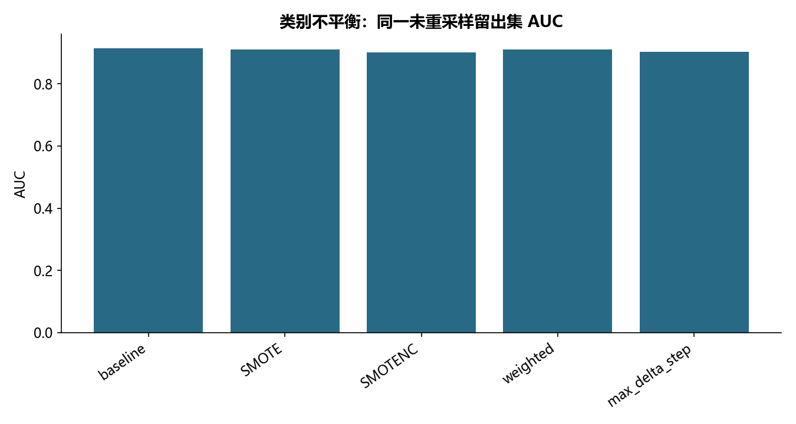

# M29 · 类别不平衡专题_课堂代码

理解类别不平衡的采样策略及类别特征插值风险。

## 实现与调整

保留六种合成采样及真实数据的SMOTE/SMOTENC、权重和更新步长比较；训练集重采样，测试集维持原分布。

编码仅拟合训练集，重采样仅作用于训练样本。普通 SMOTE 在类别代码间插值的结果保留为反例并统计非法类别行；正式类别感知比较用 SMOTENC。保留六种二维合成采样、实际基线、重采样、类别权重和 max_delta_step；测试集保持原始分布，不用准确率掩盖少数类表现。

## 运行结果

完整聚合结果见 [metrics.csv](metrics.csv)，原单元格去向见 [notebook-map.md](notebook-map.md)。

源文件按 SHA-256 校验；不加载教材附带的序列化模型。本报告的运行通过表示代码可执行并完成内部校验，不表示与旧 Notebook 的随机结果或未提供的线上结果完全一致。
