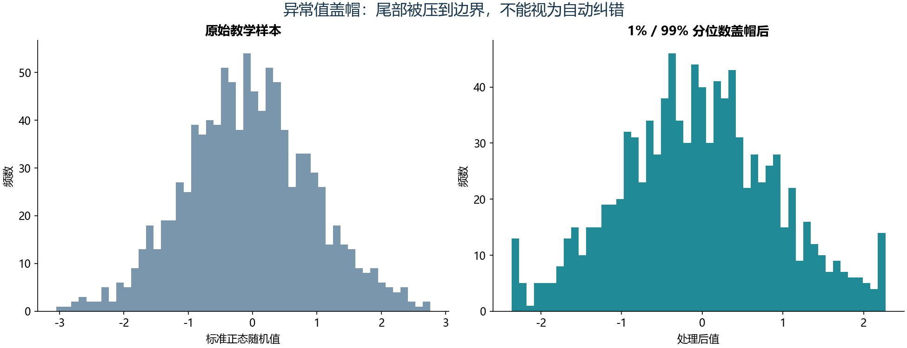

# S01 数据整合与清洗

## 实现范围

对应二级教材第4章Notebook的12个教学小节、94个代码单元。按小节重构为独立脚本，保留读取、行列操作、查询、连接、合并、排序、分组、透视、赋值、重复值、缺失和噪声处理。每个中间演示保存表格，产物索引见本地artifact_index.json。

## 实测结果

- sample.csv为5行、3列。原始文件只读，写回演示改存实验输出目录。
- big.csv为4,500行，按900行分成5块，拼接结果与整表读取逐项一致。
- 示例inner/left/right/outer连接分别为1/3/2/4行；按索引对齐与按业务键连接分别演示。
- 重复值示例全行去重后5行，按id保留首行后4行；后者会丢掉同id不同属性，不能无条件应用到业务表。
- 金额透视表汇总前后总金额一致；默认均值与显式求和分别保存。
- 盖帽修改20个随机教学样本值，边界为样本的1%和99%分位数。

## 代码含义与迁移调整

Notebook的裸表达式原本由交互环境展示，迁移后显式保存CSV/JSON。`loc`标签范围与`iloc`位置范围有不同端点规则，脚本对等价示例进行比对。横向连接增加键唯一性验证，避免意外多对多膨胀。缺失、异常、重复处理都保留原始对象，演示不会覆盖教材数据。

## 业务限制

随机数和表中人物是教材教学演示，不是实际客户分析。均值填补和分位数盖帽是待选规则，不能自动证明值错误。用于预测时，应只在训练数据拟合填补统计量与边界，再应用到验证/测试数据。本实验验证了教学流程和关键守恒关系，未声称逐单元比对Notebook缓存输出。
