# S02 Python数据可视化

## 实现范围

重构原Notebook全部22个非空代码单元，生成13幅图：线图、饼图、柱形图、条形图、直方图、散点图、箱线图、直方图与KDE、4种二元图，以及热图。[逐单元格对照](notebook-map.md)记录每项迁移，chart_inventory.csv记录图形与数据性质。

价格文件有15个交易日，从2017-08-25到2017-09-14。原表倒序，现按真实日期升序排列，不再硬编码range(15)。OHLC数值未改写，检查最高/最低与开收盘关系。图中名称和数值均取原表，没有补写证券代码或把历史片段用于投资建议。

其他例子是固定种子的模拟数据或教材给出的示意点。使用局部RandomState复现原np.random.seed的随机流，不污染调用者的全局随机状态。投票总数255，占比和为1；直方图200个样本中箱内200个、箱外0个。模拟分数与正态样本只为绘图教学，不能当作真实调研结果。

## 依赖与解释

原seaborn图形改用本仓库已有的matplotlib和scipy.gaussian_kde实现，保留二元关系、边际分布和KDE教学目的，不宣称像素级复现。KDE采用Scott带宽，直方图与KDE共用概率密度纵轴；其形状受带宽影响。热图输入是独立随机数矩阵，既不对称也不要求对角线为1，不能误标为相关矩阵。

所有图保存为PNG并关闭图形对象，可从命令行无界面运行。股票原始行级数据只留本地，公开投票表为明确标注的合成数据。本实验状态为运行通过，没有独立的图像参考评分。

## 图形

### 1. 线图

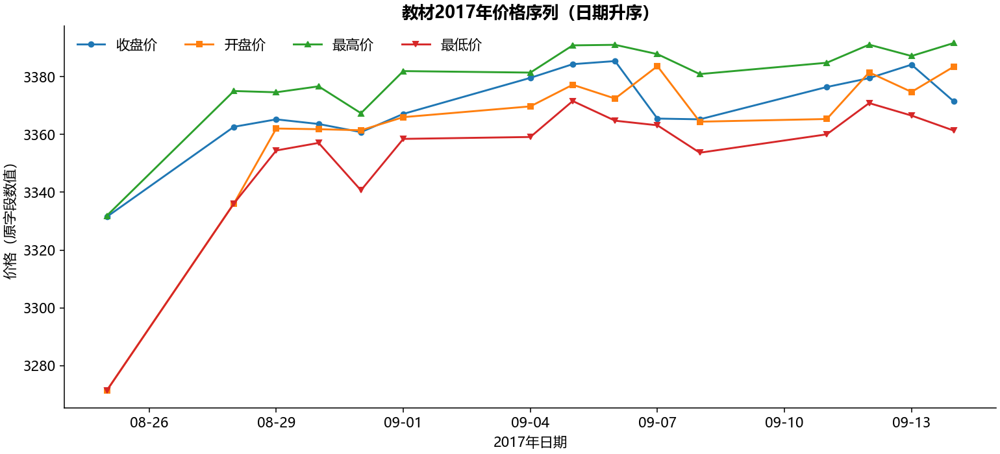

### 2. 饼图

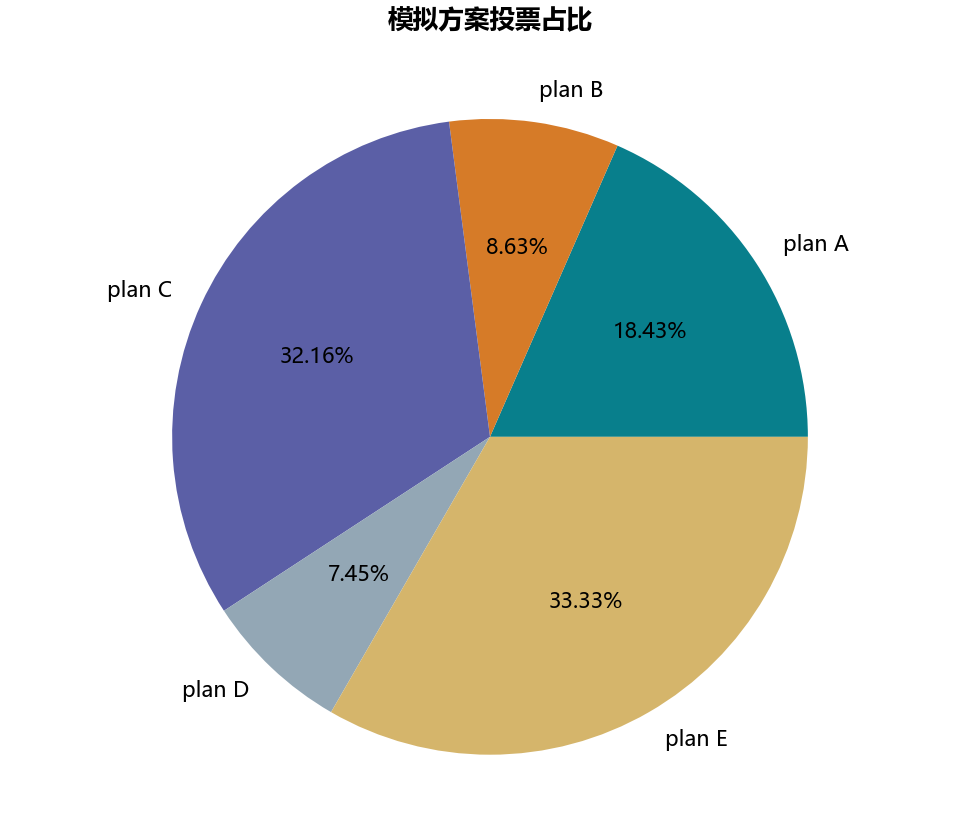

### 3. 柱形图

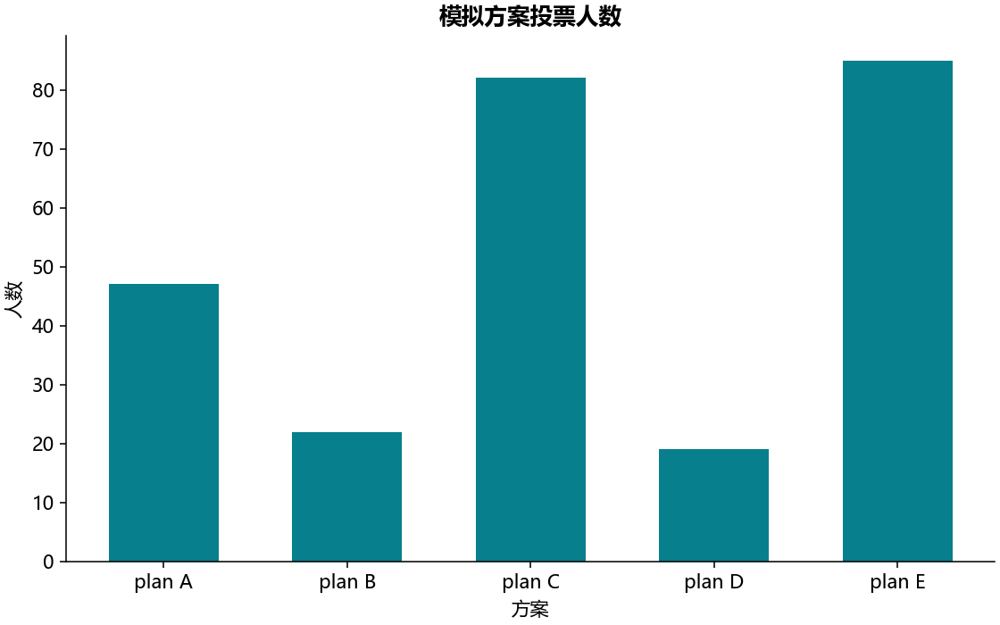

### 4. 水平条形图

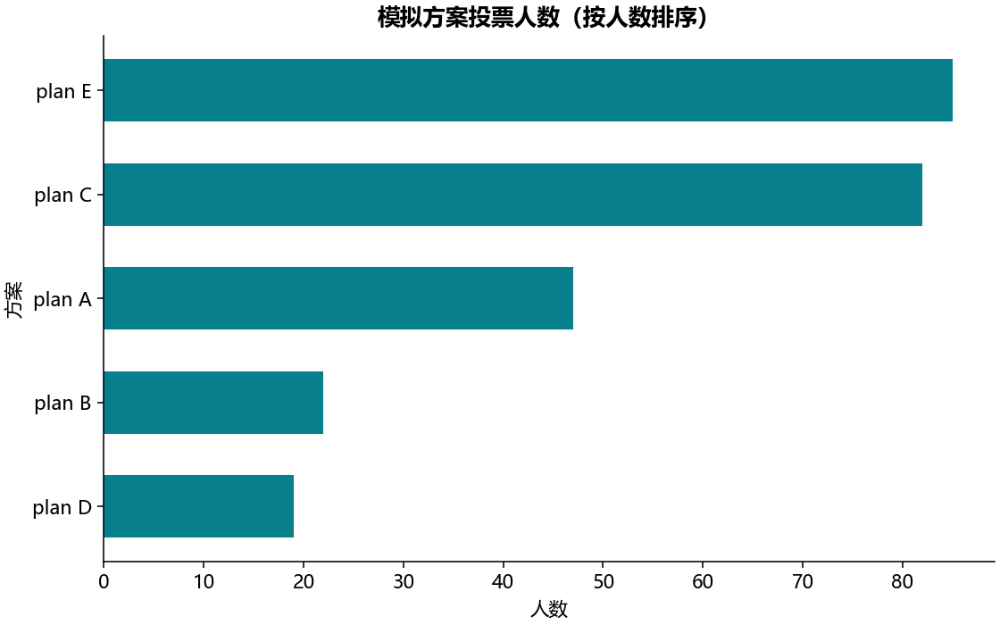

### 5. 直方图

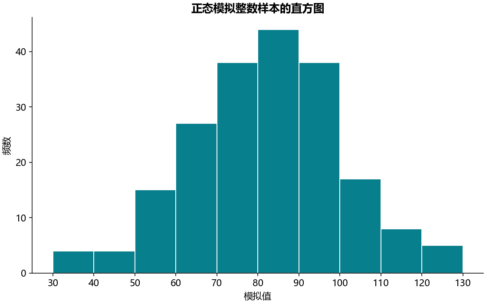

### 6. 散点图

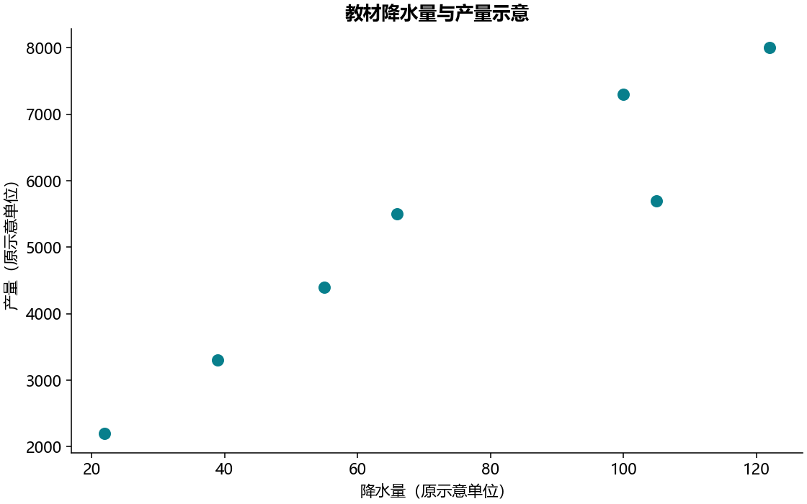

### 7. 箱线图

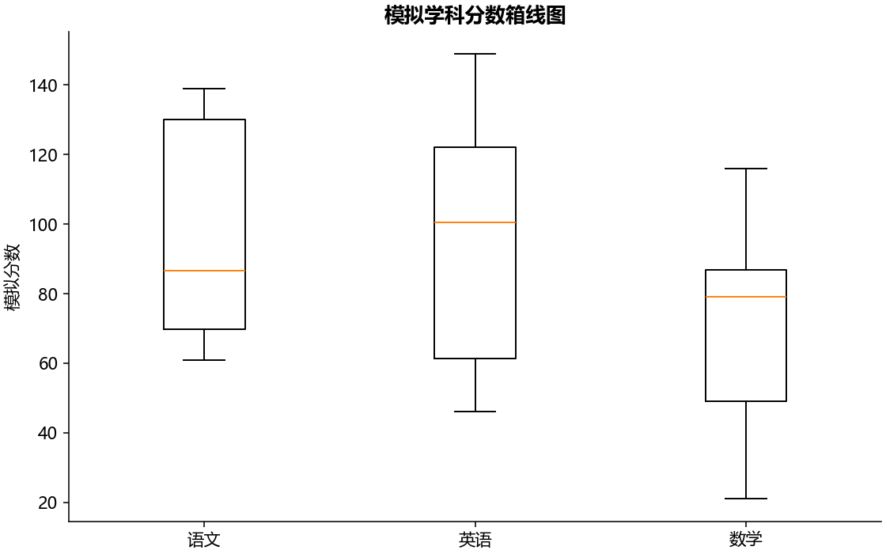

### 8. 直方图与核密度

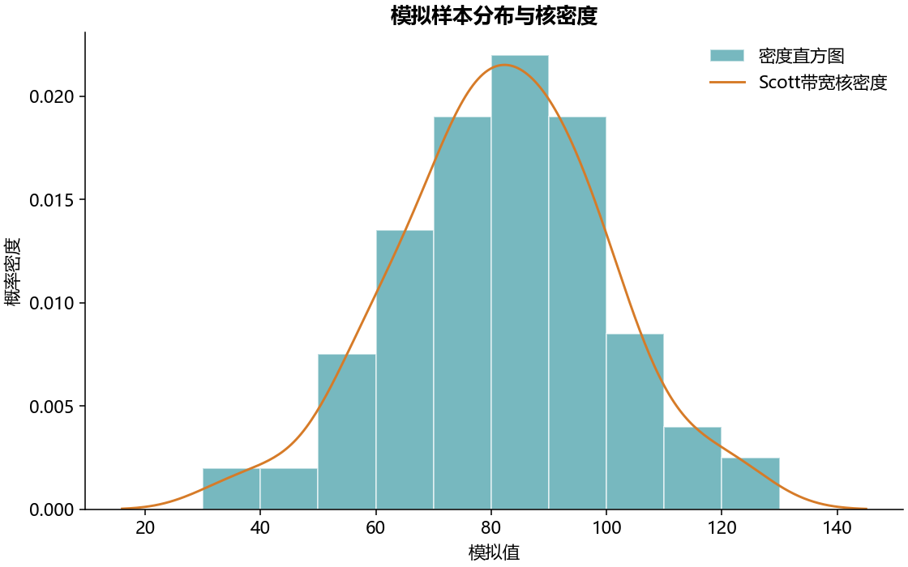

### 9. 二元散点与边际直方图

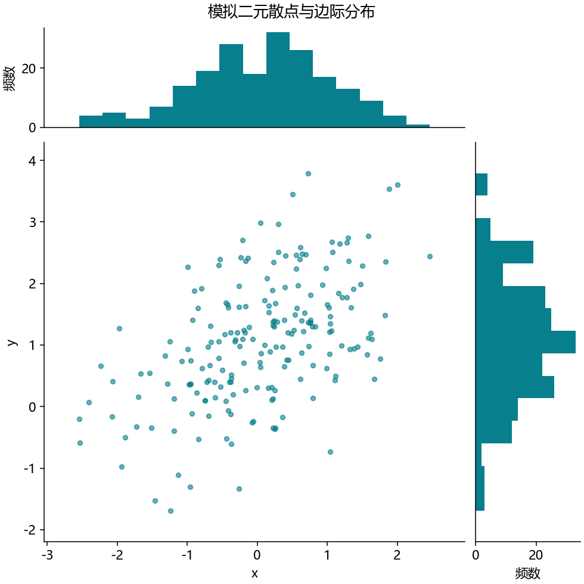

### 10. 二元关系散点图

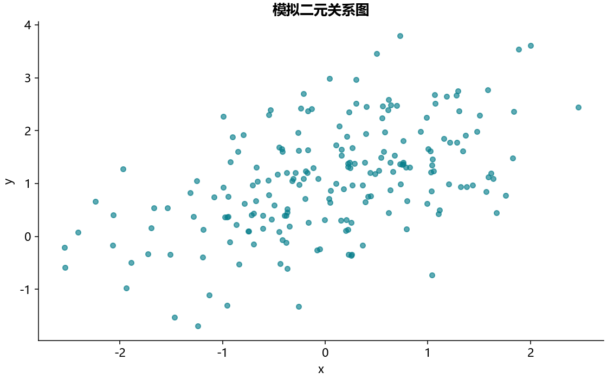

### 11. 二元核密度与边际直方图

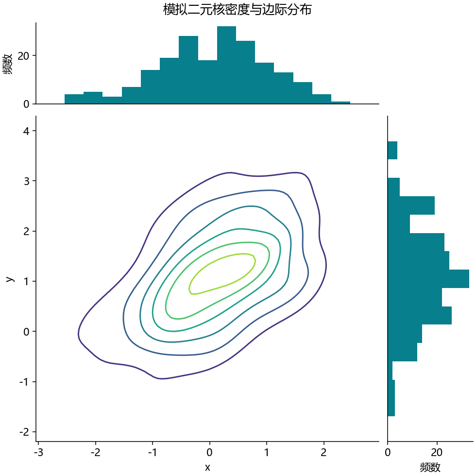

### 12. 二维核密度图

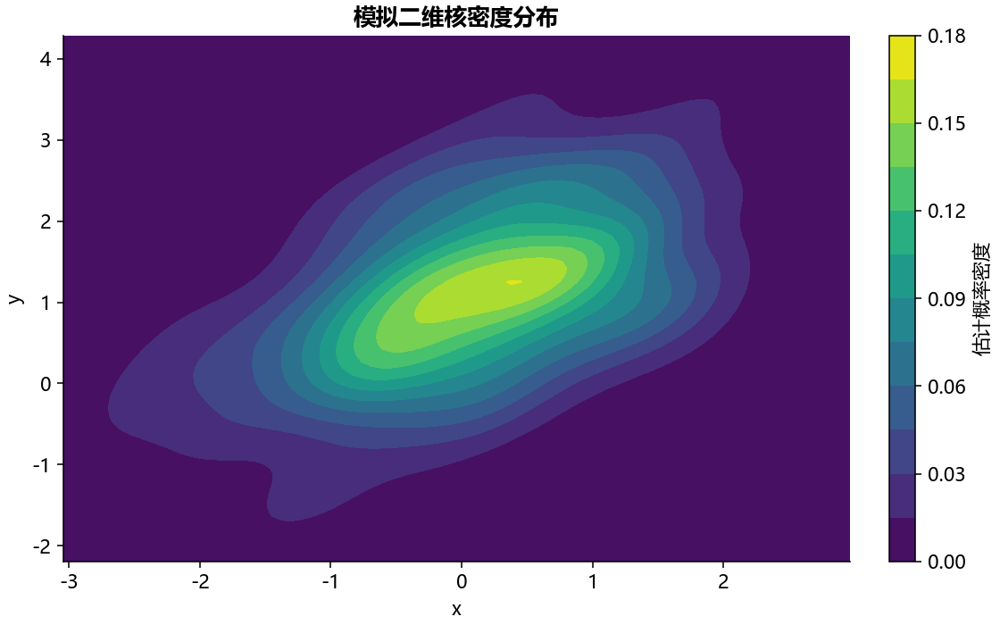

### 13. 随机矩阵热图

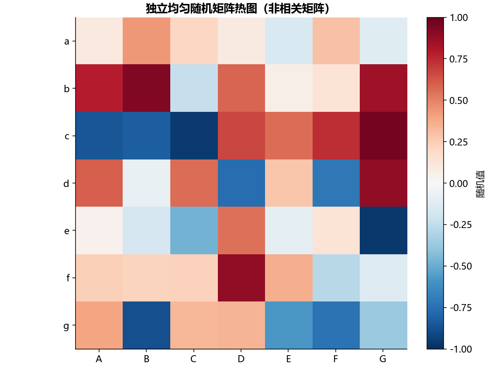
