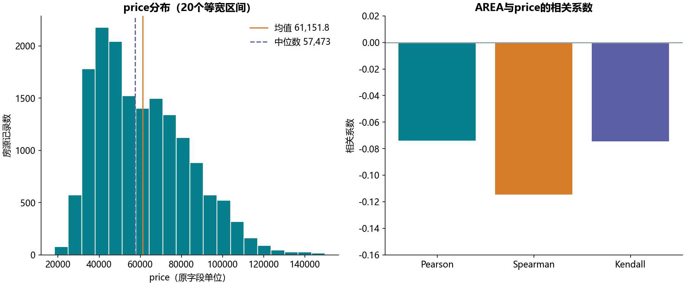

# S03 描述性统计与绘图

## 样本结果

原表有16,210条房源记录，AREA和price均无缺失。price均值61,151.810919，中位数57,473，25%/75%分位数为42,812.25/76,099.75。样本标准差22,293.358147，样本方差496,993,817.48506802，极差131,523。

均值高于中位数，说明均值受到较高price记录影响。AREA与price的Pearson为-0.073955，Spearman为-0.114628，Kendall为-0.074580，均为较弱负关联。数据没有明确价格单位、采样框和采集时间，不能据此推断某地当前房价或“面积增大会导致降价”。

## 代码内涵

describe_price集中计算位置、离散程度和相关性。方差和标准差使用pandas默认的ddof=1，分母为n−1；它们不应与总体标准差混用。分位数采用线性插值。20个直方图区间的计数之和等于16,210，没有为图形展示丢弃极端值。

Notebook另生成1000个正态随机数演示偏度与峰度，但没有种子。本实现设种子20261022，偏度为0.138283，超额峰度为-0.139098。正态总体的理论偏度和超额峰度均为0，有限随机样本不会恰好等于0；该随机演示不与旧缓存逐值对账。

## 核对范围

共12项房价统计/相关值在显示舍入与64倍机器精度的浮点容差内核对通过：3项均值/中位数/标准差、3项分位数、极差/方差/再次标准差，以及3种相关。重复标准差按不同源单元分别记录，不当作12个不同指标。旧方差缓存与本次相差2.86102294922e-06（相对约5.8e-15），并非逐位相同；按整数price用有理数公式(n×Σx²−(Σx)²)/(n×(n−1))独立复算得到496993817.48506802，与本次方差一致。每项容差、原显示字符串和实际差值见summary.json。逐单元格说明见[迁移对照](notebook-map.md)，共14个非空代码单元。
