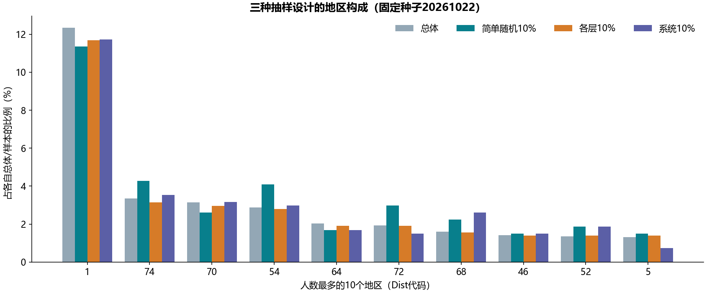

# S04 抽样设计

## 运行结果

共有5,369名不同客户，分布于77个地区。六种设计的样本量：simple_n22=22、simple_p10=537、stratified_n2=154、stratified_p10=573、systematic_n4=4、systematic_p10=537。每次以种子20261022独立启动随机数生成器，能够重复得到同一组样本。

## 代码内涵与修正

简单随机抽样等概率不放回选行。比例先取ceil(N×k)，因此10%得到537人。分层计数k代表**每层**k人，比例代表每层ceil(N_h×k)，各层向上取整导致总数573，比全局10%的537多36。每层2人的总数是154，不能解释成总体只抽2人。district_allocation.csv给出N_h/n_h设计权重，使用分层样本估计总体时需要权重；未加权的各地区占比不等于总体地区占比。

系统抽样采用间隔N/n和区间[0,N/n)内的随机起点，位置为floor(start+j×N/n)，保证恰好n个不同位置。原代码固定从0开始，以N//n+1作间隔；例如N=100、n=50会只得到34行，现已修正。系统抽样仍受原始排序周期影响，固定种子只保证可重复，不能消除周期偏差。

原来的字符串身份判断is改为值比较；每一层独立检查可抽人数，支持缺失分层键作为一层（本例没有缺失），允许完整抽取某层。按行位置抽样，DataFrame重复索引不会使同一位置被重复抽取。

## 核对范围

原Notebook缓存的总体与三种10%抽样计数共16项核对一致，但原程序未设随机种子，无法核对相同客户名单；其系统抽样方法已修正，因此状态记为运行通过。逐单元格说明见[迁移对照](notebook-map.md)。六份客户明细只保存在本地，不纳入公开仓库。
