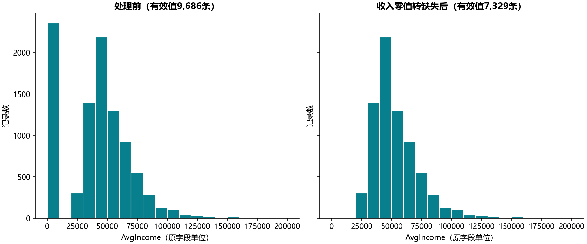

# S05 数据预处理与缺失审计

## 结果

原始数据有9,686名不同客户。教材将AvgIncome=0视作缺失的规则应用后，2,357个零值转为缺失，收入有效值剩7,329条，缺失率为24.33%。记录总数不变，不删除客户，不做填补。

收入字段均值由40,491.444249变为53,513.457361。均值变化来自零值转为缺失后统计分母改变，不能解释成客户收入上涨。前后直方图使用相同的20个区间及纵轴范围，两个图各自计数之和分别等于9686与7329。

## 代码内涵与边界

clean_income返回副本，使用np.nan替换旧写法np.NaN，并保留AvgIncome_was_zero以区分原有缺失与本次规则引入的缺失。此规则来自该教材案例，不能泛化为所有业务里的零收入都无效。没有变量字典支持时，先核对零值含义再用于实际模型。

AvgHomeValue有103个零值，原Notebook只提示检查，没有执行替换。本实现保留它们并在missingness_audit.csv列出。ARPU原有4,843个缺失，Age有2,407个缺失，也保持不变。没有使用响应标签填补数据或拟合预测模型。

## 核对范围

三个原Notebook单元格的24项描述统计按原输出显示精度核对一致：收入处理前8项、房屋价值处理前8项、房屋价值再次检查8项。最后8项是重复检查，不当作24个不同指标。清洗后收入没有describe参考输出，只有本实现的记录守恒、缺失增量和非收入字段不变检查，不宣称它也有参考统计对照。图形采用统一箱界，未按原图不同箱界逐箱对账。

逐单元格说明见[迁移对照](notebook-map.md)。清洗后的客户明细只留在本地，公开文件是聚合审计和描述统计。
