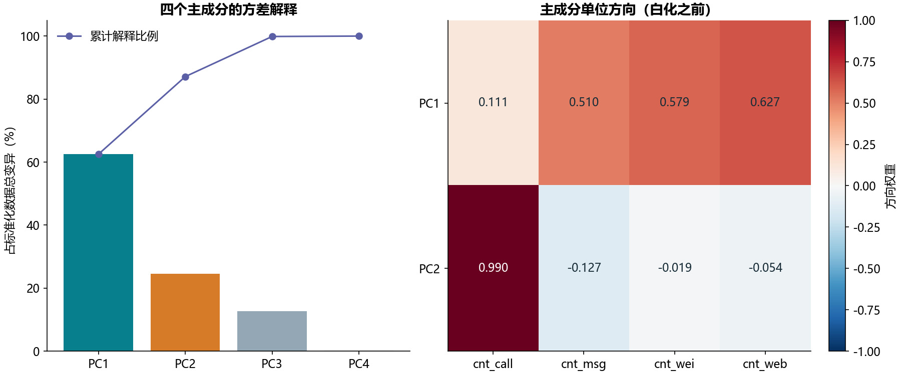

# S06 电信使用量主成分分析

## 结果与解释

600名不同客户，4个计数特征cnt_call、cnt_msg、cnt_wei、cnt_web。PC1解释62.5104%，PC2解释24.6202%，合计保留87.1307%的标准化总变异。PC1主要由消息/微信/网页使用方向构成，PC2主要是通话方向；业务名称依据原字段名作教学解释，不代表已完成聚类或客户画像验证。

## 代码内涵

先对每列减均值，再除以总体标准差（ddof=0），防止计数尺度支配PCA。PCA使用样本协方差（n−1分母），因此四个样本特征值之和为4×600/599，而不是恰好4。固定完整SVD避免不同自动求解器带来不必要差异。

教材设置whiten=True。本实现保持该设置，得分等于标准化投影除以对应样本特征值平方根，两列得分的样本协方差检查为单位矩阵。components_是单位方向，不能直接当成白化后完整得分系数；两种系数均在component_directions.csv分开列出。主成分整体正负号不影响解释比例，本实现约定最大绝对方向权重为正。

## 核对与限制

28项缓存数值按显示精度核对：2个解释比例、8个方向权重、6个不重复相关系数，以及源输出前后三行的12个白化得分。原缓存中间594行被省略，不能声称1200个得分全部对过参考。独立检查覆盖全部得分的均值、样本协方差和有限性，ID未入模，客户得分仅保存在本地。

这是对本样本的描述性降维，没有训练测试评估或分群标签。用于预测流水线时应仅在训练分区拟合标准化和PCA。全部6个非空代码单元见[迁移对照](notebook-map.md)。[scikit-learn官方PCA文档](https://scikit-learn.org/1.6/modules/generated/sklearn.decomposition.PCA.html)说明白化及解释方差口径。
