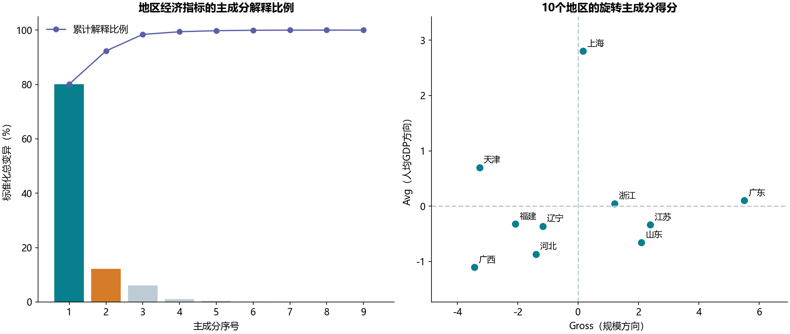

# S07 地区经济数据的主成分旋转

## 结果

10个地区、9个指标。前两个主成分累计保留92.3279%的标准化总变异，样本特征值为8.011296和1.221493。按教材选取两维，再做varimax正交旋转。

旋转方向Gross的8个规模相关变量权重大多为正，Avg的X2（人均GDP）权重最大。名称是对本样本方向的解释，不是已经验证的潜在因果因子，也没有把不同方向合成为客观综合排名。来源含省、直辖市等地区，不能统称10座城市；原材料没有明确年度和单位，不能写成当前经济表现。

## 原方法与Python实现

源Notebook虽称“因子分析”，实际调用fa_kit默认的协方差特征分解、保留两列**单位范数特征向量**并旋转，再以Z×方向矩阵作为得分。本实现用完整SVD和现有statsmodels.rotate_factors重建这一流程，没有改换为最大似然共同因子模型，也没有将特征向量乘以特征值平方根后再旋转。

方向系数与“变量和得分的相关系数”不同，分别保存在rotated_directions.csv与feature_score_correlations.csv。旋转矩阵正交、保留子空间投影相同、总保留方差不变和varimax梯度收敛均独立检查。**方向正交不等于得分不相关**：旋转后两列得分相关为0.097194，因为原两主成分的方差不相等。没有白化这两列得分。

PCA以ddof=0标准化、n−1协方差计算，本例9个样本特征值之和为10而非9。教材的“累计解释超过85%、最后保留特征值高于0.8”在本例支持两维，但不应机械推广为通用选维规则。10个样本相对9个变量很少，本结果仅是教学描述。

## 核对范围和来源

148项缓存值按显示精度核对：90个标准化值、9个特征值、9个解释比例、再次显示的2个保留特征值、18个旋转方向和全部20个地区得分。原Notebook另有重复显示，这里没有重复计数。每项差值和容差记录在summary.json，全部24个非空代码单元见[迁移对照](notebook-map.md)。

方法语义核对依据[fa_kit提取源码](https://github.com/bmcmenamin/fa_kit/blob/master/fa_kit/extraction.py)、[旋转源码](https://github.com/bmcmenamin/fa_kit/blob/master/fa_kit/rotation.py)和[数据预处理源码](https://github.com/bmcmenamin/fa_kit/blob/master/fa_kit/factor_analysis.py)。实际旋转调用[statsmodels官方接口](https://www.statsmodels.org/stable/generated/statsmodels.multivariate.factor_rotation.rotate_factors.html)，不捆绑或执行fa_kit源文件。
