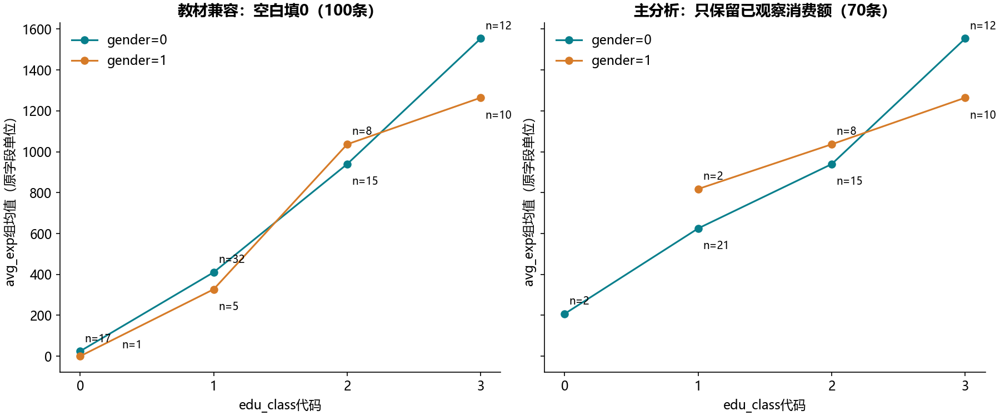

# S08 消费额方差分析与样本口径

## 原始问题与主分析

100条客户记录中，30条avg_exp为空白字符串；这30条全部属于Acc=0。空白表示没有可用消费额，不能凭代码自动视作真实0。主分析保留70条已观察消费额，未观察记录不补0；兼容分支按教材填0，仅用于重现原结果。

教材标题“单因素”下的公式实际同时包含教育和性别。本实现新增真正的教育单因素模型，再给出教育+性别加性模型。主分析加性模型Type II教育项p=3.81399e-12、性别项p=0.487708，另提供HC3异方差稳健检验。它们反映观察样本中的条件关联，不代表教育或性别的因果效应。

## 空单元格与可识别交互

主样本中edu_class=0、gender=1组合没有记录。标准完整交互设计有8列、秩7，存在1个不可识别维度，不能照搬100条兼容样本的8个系数或3自由度交互解释。

因此用实际观察到的7个教育×性别单元拟合满秩单元均值模型，与加性模型做嵌套比较：可检验增量自由度2，F=3.326974、p=0.042309。这是观察单元上的加性拟合不足检验，不能补出缺失组合的均值。单因素F与scipy.f_oneway独立核对。

## 假设与核对

最小观察单元仅2条记录。基于单元的中位数Levene检验p=0.030323，在α=0.05下提示方差不齐。对同一组可识别交互对比另计算HC3稳健Wald F=1.615415、p=0.206934（分子/分母自由度2/63）。经典交互F依赖等方差假设，不能单凭其接近0.05的p值宣称存在稳定交互；稳健检验在小组样本下也需谨慎解释。

经典Type II表、HC3表及观察单元交互检验分开输出，所检验的假设不同。HC3行只输出df/F/p，平方和留空，避免将稳健检验派生的数值误当作可加的总变异分解。模型残差平方和单独记录于model_comparison.csv。没有把同一数据上的多个p值当作多份独立证据。

兼容分支的两个OLS模型共25项原缓存值核对：13个系数，以及每个模型的样本数、模型/残差自由度、R²、总体F与总体p。只按原打印精度对账。主流程改变了响应缺失处理，因此实验状态记为运行通过，不宣称修正后的70条分析有同一参考答案。教材重复的A+B+A*B公式简化成A*B，设计矩阵含义不变。

原表没有完整单位、采样与Acc定义字典。本报告保留代码含义，不能将70条选择后的消费样本推广到所有申请客户。原记录不改写，公开文件为模型/分组汇总。[statsmodels官方文档](https://www.statsmodels.org/stable/generated/statsmodels.stats.anova.anova_lm.html)说明Type II和HC3的检验口径。全部6个非空代码单元见[迁移对照](notebook-map.md)。
