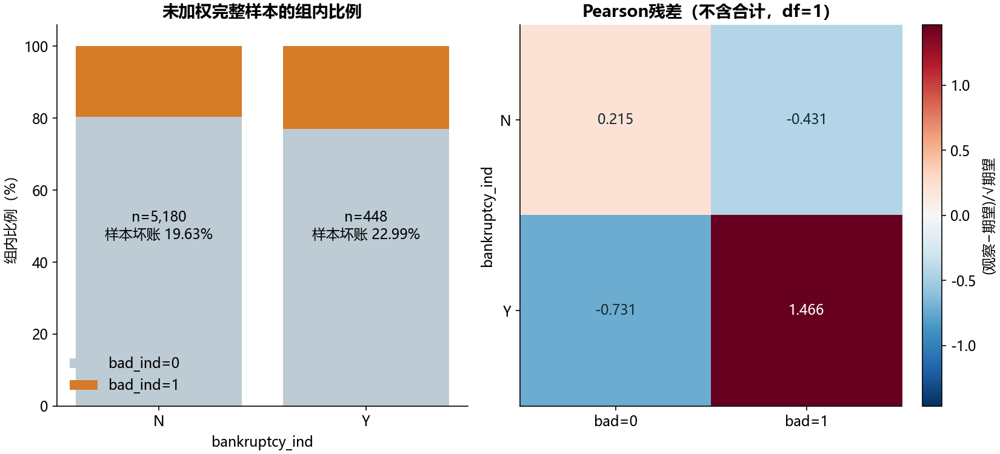

# S09 列联表与独立性检验

## 样本与正确检验

原表5,845条不同申请，bankruptcy_ind缺失217条。主分析采用5,628条完整记录，没有把缺失值填成N。N组样本坏账比例19.6332%，Y组22.9911%；这不是因果差异。

去除All合计行列后：未作连续性校正的Pearson χ²=2.916667，df=1，p=0.087669；Yates校正p=0.099732；双侧Fisher p=0.095653。Cramér's V=0.022765，最小期望频数89.154。

## 原代码问题与核对

教材把含All合计的3×3展示表传给chi2_contingency，产生df=4、p=0.571866。合计不是独立观测类别，这个自由度和p值不适用。在本表中错误流程的未校正χ²恰与正确2×2 Pearson相同，但自由度改变，所以p值不同；不能因统计量相同就认为实现正确。

只在独立诊断分支重建错误旧流程：9个展示频数、9个行比例、9个旧期望频数和χ²/p/df共30项按缓存显示精度核对。主流程已经修正，状态记为运行通过，未把旧p值当正确答案。test_comparison.csv用INVALID前缀明确标记旧行。

## 解释边界

若事先用α=0.05，三种正确检验均未拒绝独立性假设，不能据此断言两者完全无关系或两组风险等同。各检验回答的是样本分类关联，单变量结果也不是可部署的风控模型。

weight字段含1和4.75，教材未给出抽样权重定义。本实验遵循原例使用未加权样本计数，不把加权伪频数送入普通Pearson检验，不把样本坏账比例推广为总体概率。缺失记录的排除也可能影响代表性。公式、自由度及Yates行为参见[SciPy官方文档](https://docs.scipy.org/doc/scipy/reference/generated/scipy.stats.chi2_contingency.html)。全部3个非空代码单元见[迁移对照](notebook-map.md)。
