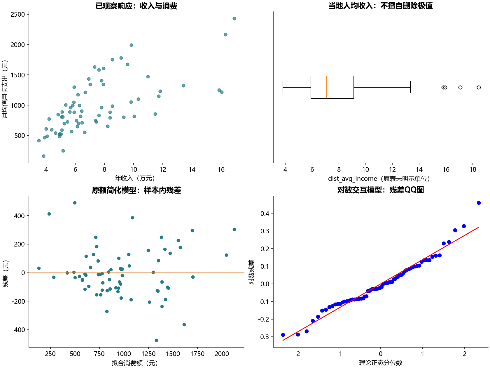
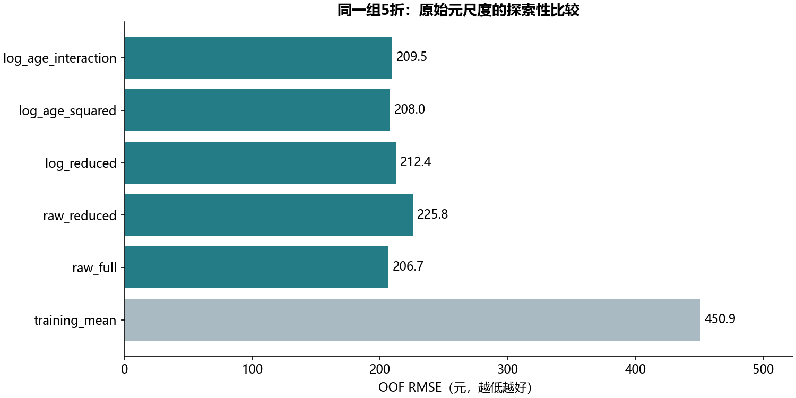

# S10 信用卡消费线性回归

76条记录中6条消费额缺失；正式分析只用70条已观察响应。年龄999与教育缺失发生在同一条响应缺失记录，因此它已随缺失响应排除，没有额外删掉已观察样本。原始资料保持只读。数据字典将avg_exp定义为月均信用卡支出（元），Income为年收入（万元）；当地人均收入单位未明确，不猜测。

## 代码与教材修正

prepare分别建立正式样本与明确标记INVALID的教材兼容分支。后者为复核缓存而用总体均值填6个响应，替换999年龄，保留教育首次出现序码。填补预测目标会制造观测，不能用于正式推断或验证。5个兼容OLS共核对89项系数和统计量，另核对8个教材VIF；这不代表修正后的主模型与教材数值相同。

正式模型将教育当分类。共线性诊断使用实际含哑变量的设计矩阵，保留截距参与辅助回归；id、Acc、edad2不入模。Pearson和Kendall只比较实际数值字段，不把教育序码当等距数值。fit_estimable拒绝不可识别设计。

## 预测验证与解释

五个候选变体依次为原额全变量、去当地人均收入、对数简化、对数加年龄平方、对数加年龄平方及年龄×性别。相同的固定5折共70个OOF预测；编码和标准化仅在每折训练集拟合。对数模型使用训练残差的mean(exp(residual))作回变换修正，它依赖残差分布可迁移假设，不等于保证预测条件均值无偏。训练均值基线也逐折重算。

所有RMSE/MAE都在元尺度计算；原额和对数模型的样本内R²、AIC不可直接跨响应尺度挑选优胜者。这是70条小样本上的探索性同折比较，没有独立最终测试集；据此挑模型后仍需要新样本验证。所有回归系数是条件关联，不是营销干预因果效应。负预测数单独报告，未为改善分数截断。

教育类别词表按教材字段含义预先固定为中学、大学、小学及以下、研究生，中学为基线。正式样本小学及以下仅2条，同一验证折都未出现在对应训练集中；这两条的该类别增量无法学习，最小二乘按零增量处理，即回退基线。每折训练未覆盖教育类别的验证人数写入摘要，这也是本次小样本验证的局限。

客户记录和OOF预测仅存本地，公开模型系数、聚合诊断和图形。[逐单元格迁移](notebook-map.md)说明全部教学内容去向。
