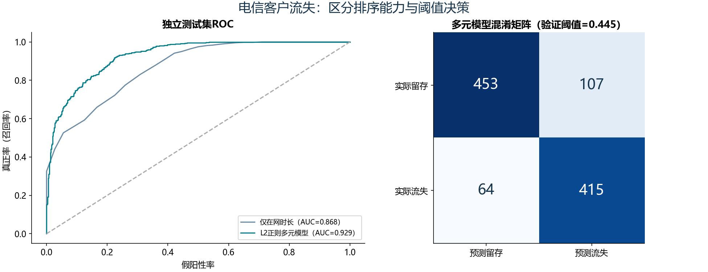

# S11 电信客户流失逻辑回归

## 业务问题与数据

估计客户流失概率，解释在网时长、使用行为与客户属性的统计关系。数据3,463名不同客户、20列，churn=1为流失。subscriberID仅作分区和追溯，不进入模型。

沿用教材random_state=666的70%抽样：训练2,424人、独立测试1,039人。训练部分再分为拟合1,939人和验证485人，用验证集Youden指数选择阈值0.445304，再用完整训练部分重新拟合多元模型。测试集不参与变量筛选或阈值选择。

教材未正则多元Logit在当前环境中没有收敛，极端系数绝对值达到39.67。保留失败诊断，主模型采用相同预测变量、训练内标准化、独热编码和L2正则逻辑回归，C固定为1.0。该结果不冒充与教材未正则模型数值一致。

## 独立测试结果

| 模型 | 阈值 | ROC AUC | 精确率 | 召回率 | F1 |
|---|---:|---:|---:|---:|---:|
| duration_textbook_0.3 | 0.3000 | 0.8680 | 0.6651 | 0.9123 | 0.7694 |
| multivariate_l2_0.5 | 0.5000 | 0.9290 | 0.8076 | 0.8413 | 0.8241 |
| multivariate_l2_validation_cutoff | 0.4453 | 0.9290 | 0.7950 | 0.8664 | 0.8292 |

验证阈值下，多元模型识别流失客户415人，漏判64人，误报107人。阈值可以改变召回与误报的平衡，AUC不随所选分类阈值改变。Youden指数没有直接编码营销成本和挽留收益，不能称为商业利润最优阈值。

## 从Notebook到脚本的修正

1. 保留单变量duration、教材多元公式的收敛诊断、训练集前向AIC练习、分类列联检验、概率预测、阈值分析、ROC和VIF诊断。多元主模型采用上述明确说明的L2调整。
2. 原Notebook阈值循环中的precision/recall等名称与实际分母不一致。这里按正类churn=1统一：precision=TP/(TP+FP)，recall=TP/(TP+FN)，specificity=TN/(TN+FP)。
3. 原Notebook在测试集上挑“最优阈值”。这里把选择过程移到训练部分内的验证集，阈值灵敏度表也只使用该验证集。
4. 前向AIC使用仅截距模型初始化，候选顺序固定；分类检验仅用训练数据，未按测试结果改变预测变量。它是另一个教学诊断，不冒充多元模型的自动来源。
5. 裸表达式和show改为明确的CSV、JSON、图和报告。取消原代码中基于位置歧义的Series索引写法。

## 解释与限制

逻辑回归为logit(p)=β0+Σβx。正则模型数值变量按训练标准差缩放，exp(β)解释为增加一个训练标准差对应的优势比；分类变量相对被删除的基准水平解释。正则系数不附加未经计算的经典p值或置信区间。这里是样本观察关联，不是干预的因果效应。随机划分只证明同分布历史样本上的表现，尚未验证未来月份或其他运营商。

本实验检查了主模型收敛、客户分区不重叠和概率有效性；未正则教材多元公式的收敛失败单独记录，未逐项核对原Notebook缓存数值。重新拟合可能改变验证时的概率尺度，阈值也需要在新业务样本上重新验证。类别集合只在对应训练分区学习，遇到未知测试类别明确报错。

本地另有coefficients.csv、forward_aic.csv、categorical_screening.csv、vif.csv、validation_threshold_sweep.csv，以及不纳入公开仓库的客户级预测与分区表。
