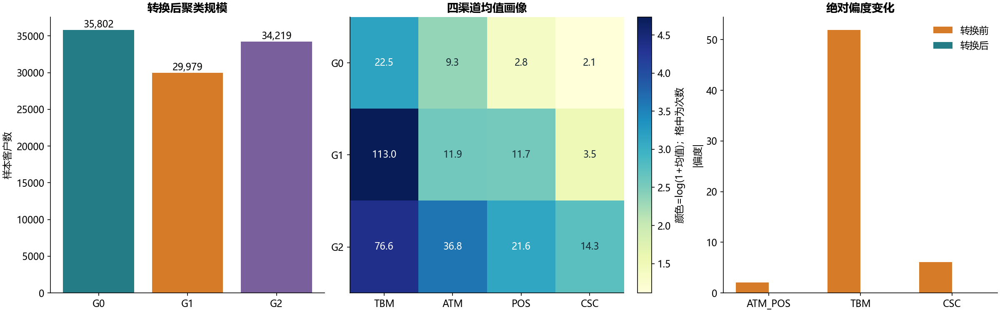
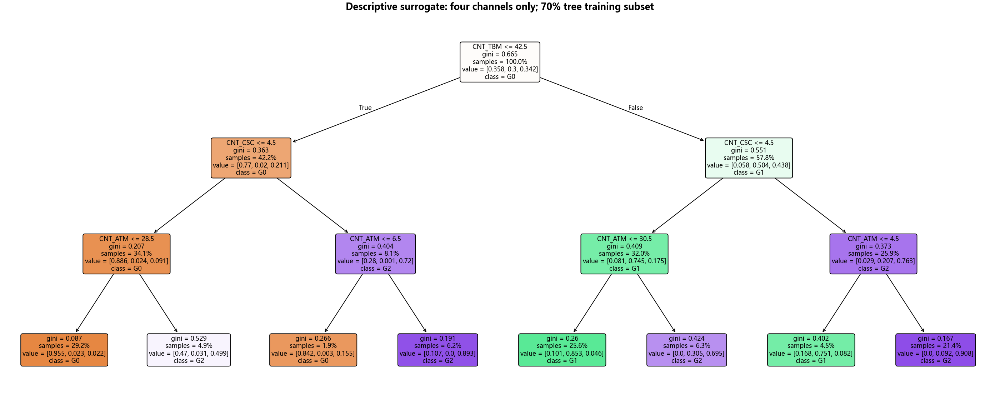

# S12 银行客户渠道使用分群

10万条唯一客户记录，四个渠道计数非负且无缺失，CNT_TOT逐条等于四项之和。ID仅用于本地记录关联，ID和CNT_TOT均不作为降维、聚类或替代树特征。原教材将它们放入事后解释树；编号可能制造无业务意义的切分，本实现移除。

## 从渠道到分群

四项渠道先标准化，再取3个单位主成分方向，保留83.607657%变异，随后做varimax，命名ATM_POS、TBM、CSC。方向正交与子空间不变经过检查。缓存共核对39个值：3个特征值、3个方差占比、12个方向、前5行15个得分、转换前后6个绝对偏度。其余客户得分未有完整教材缓存可对账。

分位数转换显式指定n_quantiles=1000、subsample=10000、random_state=0，复现教材偏度。抽样估计的边际变换改变欧氏距离，不能保证联合正态，也不表示数据质量必然更好。没有用结果倒推参数，10000为本环境sklearn 1.6的默认抽样量，显式固定以免后续版本漂移。见[QuantileTransformer官方说明](https://scikit-learn.org/1.6/modules/generated/sklearn.preprocessing.QuantileTransformer.html)。

两种得分各自用KMeans(k=3,n_init=10,random_state=20261023,max_iter=300)拟合。标签按中心排序固定展示，原始标签数字没有业务等级含义。教材Kmeans没有固定种子，公开缓存只有人数和少量标签，无法核对完整旧分区；本次不强求教材35582/34385/30033的人数或标签顺序。显式n_init依据[KMeans官方接口](https://scikit-learn.org/1.6/modules/generated/sklearn.cluster.KMeans.html)。

转换后分群规模为35802, 29979, 34219人。另一固定种子重拟合的ARI=0.985410，只衡量本次初始化稳定性，不证明3群是最佳群数。原得分与转换得分的惯性使用不同几何，不能直接比较大小。轮廓系数采用固定均匀2000人子样本；若抽不到两个群则记为空，并记录实际抽到群数。稀有极端群在抽样评价中可能被遗漏，不能只凭该指标裁决。

## 替代树的边界

树只解释已经由全样本描述性聚类生成的标签。固定分层70%/30%拆分用于树拟合；保留部分的标签拟合一致率86.2500%，不是预测真实业务类别的准确率，也不是未见客户分群效果的独立验证。它只用原始四渠道，深度3，最小叶子100；规则见surrogate_rules.txt。

群像以原渠道次数的均值和中位数解释，不能据此宣称客户价值、盈利或营销增量。客户ID、各行得分和标签留在本地。[全部代码单元迁移](notebook-map.md)覆盖两套聚类及解释树。
