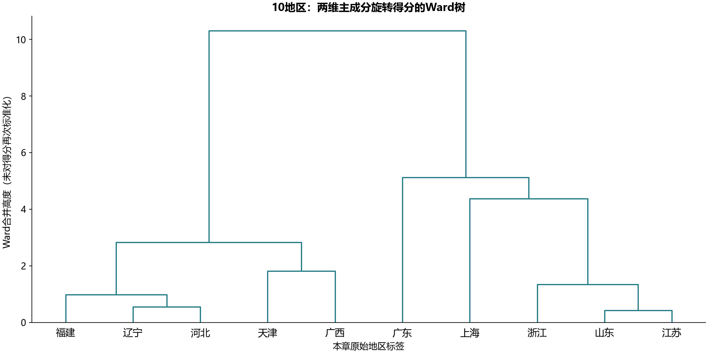
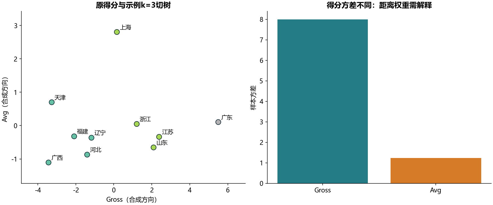

# S13 地区层次聚类

本章cities_10.csv包含10个地区、9项指标。地区标签逐行以本章文件为准：第7章同名数据的辽宁与福建标签位置不同，不能沿用前一实验的地区得分表。源表与本章提供的fa_cities_10.csv已核对AREA及9项原始数值。

## 实现与参考核对

九项指标先按ddof=0标准化，保留前两主成分92.327887%变异，旋转单位方向得到Gross、Avg。重算得分与提供CSV在绝对加相对容差1e-6内一致。原缓存权重打印8位，fa_kit与statsmodels的停止规则使末位有微小差别；18项权重单独采用3e-8绝对加相对容差，最大绝对差4.43e-09，没有宣称全部打印末位一致。

另有42项按原打印精度核对：3个特征值、3个方差占比、全部9次Ward合并的36个值。正交旋转保持两维保留子空间的所有欧氏距离，因而上述权重末位差别不会改变本例树；本次树与提供CSV所建树在1e-10绝对加相对容差内一致，k=2/3/4分区相同。源Notebook的写文件步骤改为outputs内的派生文件，教材原文件始终只读。

ward_scores先pdist得到45个欧氏压缩距离，再linkage(method='ward')。树的每行是左右节点、合并高度、成员数；高度按Ward簇内平方误差准则更新，不能直接当作两城市原始距离。最后节点成员数10、节点引用合法、合并高度单调均经过检查。接口含义见[SciPy官方说明](https://docs.scipy.org/doc/scipy/reference/generated/scipy.cluster.hierarchy.linkage.html)。

## 解释与敏感性

教材只画树，没有给定最优群数。本实现附加k=3和k=4只为教学演示；分组编号没有高低等级含义。保持源流程，不对Gross、Avg再次标准化；它们方差不同，在原得分距离中贡献也不同。scale_sensitivity.csv记录再标准化后k=2/3/4分区ARI，显示距离定义对结论的影响，不能据此证明哪种距离更正确。

树的cophenetic相关为0.715211，只描述本样本树对成对距离的拟合。10地区样本、未明确年度与单位的X1至X9不能支持当前地区绩效排名或总体推广。公共输出仅含派生地区得分、树和聚合统计，不重新发布原始9项指标。[代码迁移](notebook-map.md)覆盖全部非空代码单元。
