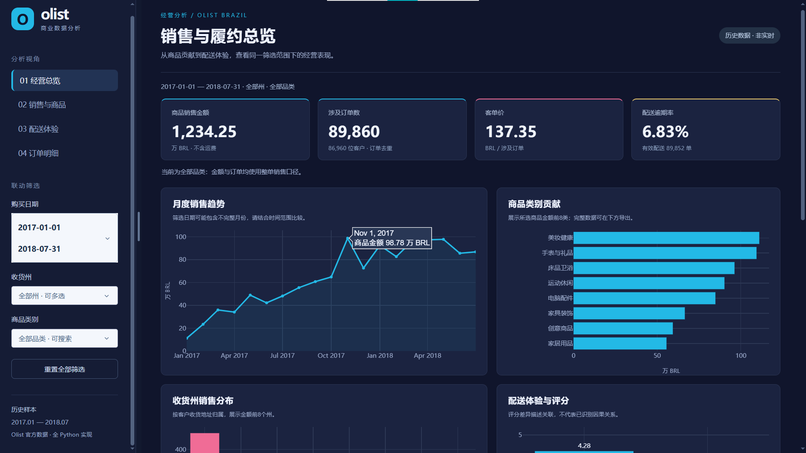
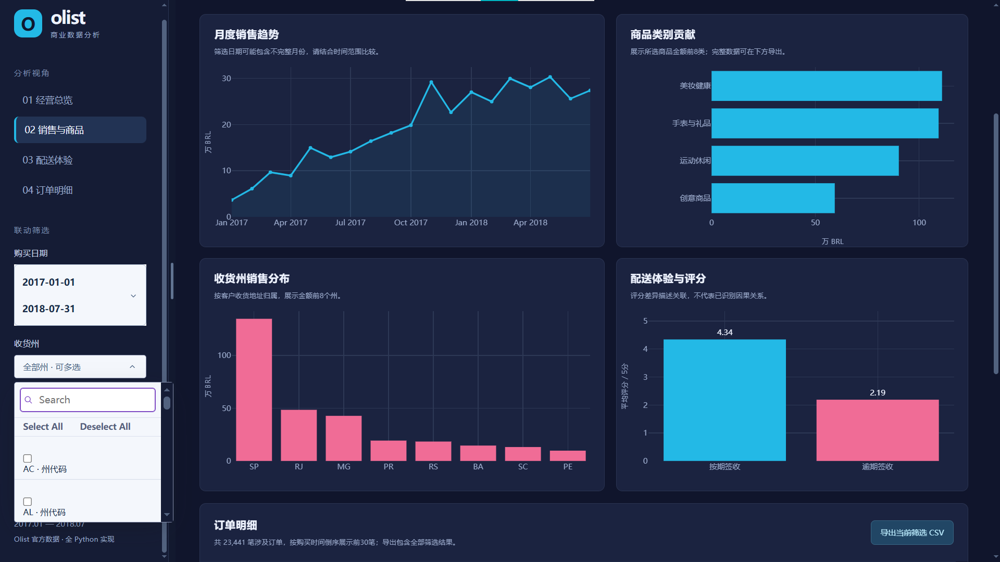
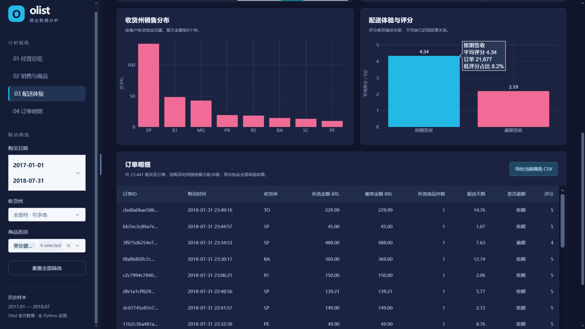

# 看板真实截图与验收

2026年11月5日，作者在本机Edge浏览器中实际操作并确认以下三张最终截图。图片原样保留，为真实运行页面；15张独立分析图的计数不包含这些截图。

| 截图 | 论文位置 | 展示内容 |
|---|---|---|
| [经营总览与趋势悬停](dashboard_01_overview_hover.png) | 图9(a) | 全期、全部州和品类；1,234.25万BRL、89,860单；2017年11月悬停98.78万BRL |
| [四品类筛选与州菜单](dashboard_02_filters.png) | 图9(b) | 美妆健康、手表与礼品、运动休闲、创意商品；23,441单；州搜索和多选菜单；02导航高亮 |
| [配送悬停与订单明细](dashboard_03_delivery_orders.png) | 图9(c) | 同一四品类范围；按期评分4.34、21,677单、低评分8.2%；03导航高亮和明细金额两列 |

## 验收来源

日期、SP州及组合筛选、导出与重置由作者操作后确认正常；悬停、下拉菜单、图表及明细显示由上述截图补证。导航和分栏脚本另外核查点击/滚动跟随、拖动边界、双击恢复、键盘及禁用存储情形。

Python脚本核查原始金额、去重、分母、三张金额图的万BRL单位、空结果、真实HTTP回调、CSV和重置。验证范围及截图哈希见[验收清单](acceptance_manifest.json)。脚本不执行浏览器点击，浏览器操作证据与程序结果分开保存。

下载的订单级CSV仅本地核对，不在仓库分发；截图中仅为Olist公开样本的局部订单信息，没有学校、作者身份、账号或浏览器书签。
