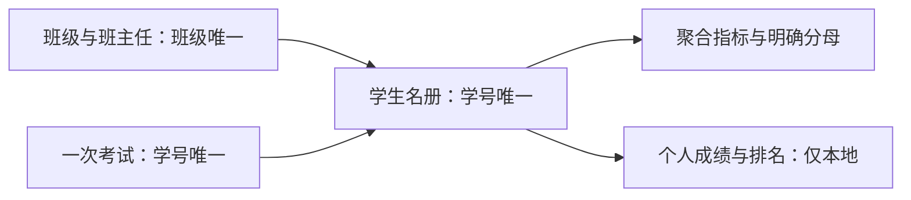

# B15 学生考试多表分析

学生名册与一次考试按学号一对一关联，再按班级多对一关联班主任，区分缺考、已知分数、完整总分及筛选分母。

```powershell
python run_labs.py --lab B15
python labs/cda1_business/b15_exams/main.py --classes 1 3 --output-root outputs/filtered
```

及格为>=60，三科各0—100；缺失不填0。完整三科才计算总分；并列总分竞争排名为1、1、3。保留全年级排名和当前筛选范围排名；班级比例的固定全年级分母另列。无考试日期，重复学号不猜测最近一次，不计算考试年龄。



查看[实现](../../../src/bda_labs/student_exams.py)、[结果报告](../../../docs/results/B15/report.md)和[工作表对照](../../../docs/results/B15/workbook-map.md)。学生/教师姓名、学号、生日、逐人成绩与排名不公开。源DAX未解码，区间端点、均分和分组都明示新实现的定义与差异范围。
