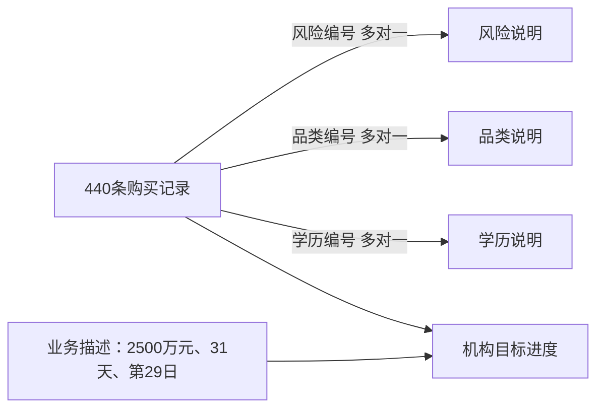

# B19 银行产品购买看板

将月内购买记录关联产品、风险、学历维度，生成产品画像、客群分布、原因/目的频次及明确分母的目标进度。

```powershell
python run_labs.py --lab B19
python labs/cda1_business/b19_bank_products/main.py --saved-path --output-root outputs/filtered
```

[计算模块](../../../src/bda_labs/bank_products.py) · [结果与口径](../../../docs/results/B19/report.md)



440行为购买记录，源没有客户ID或交易日期，不能直接去重客户或生成日趋势。月目标2500万元，31天、第29日的依据是工作簿业务描述；整月达成与均匀时间进度比较分开，筛选后不虚构局部目标。原词云以短语计数条形图迁移，原PBIX二进制模型和隐藏DAX未解码，6个容器有明确去向。
