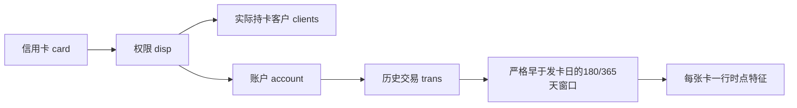

# B21 SQL与信用卡时点画像

```powershell
python run_labs.py --lab B21
```

[计算模块](../../../src/bda_labs/sql_profiles.py) · [SQL主题与窗口说明](../../../docs/results/B21/report.md)

SQL1—SQL9以SQLite和pandas独立实现，源服务器导入脚本只读。8实体加5个无表头教学表在本地重建；一卡一行，发卡前180/365天分别计算，同日交易排除，最近日并列余额保留不确定性。客户标签、窗口和缺失规则有字典，无法由输入支持的职业、婚姻、设备等标签不伪造。



余额是存量，交易行平均余额不等于平均每日资产。公开仅按卡类型/性别聚合，逐卡日期、标识和行为值只留本地。模板是参考定义，不代表所有字段已有真实业务事实。
